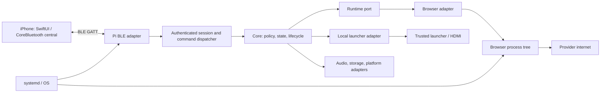

# System design

Status: proposed, 2026-11-27. Owner direction is in [PRD](../../PRD.md); all mechanisms below remain conditional on ADR validation. See [boundaries](MODULE_BOUNDARIES.md), [protocol](BLE_PROTOCOL.md), [threats](THREAT_MODEL.md).



Phone and Pi require no shared IP network. Provider internet belongs to the browser/runtime. The launcher is a separate trust domain from provider pages; a local browser origin is not proof of trust. Launcher IPC mechanism is unresolved: Unix socket mediated by a narrow broker is a candidate; any loopback endpoint must prove origin, CSRF, rebinding and local-process isolation. A shared UID, reachable loopback or arbitrary CDP TCP port is insufficient as a boundary. Do not expose secrets or privileged bridges to provider pages.

## Processes and ownership

A non-root daemon composes transport, session, policy and adapters. systemd supervises it and a separate graphical/browser process group. Core owns desired foreground app and serialized transitions; systemd owns restart and cgroup accounting. Browser sandbox remains enabled, dedicated profile persists provider sessions, and no raw debugging interface is accessible to external pages or LAN. CDP over a private pipe is a candidate, subject to browser behavior and hostile-page isolation tests; it is not a general remote API. One foreground application does not imply one browser OS process. Display seat, GPU and audio access require least-privilege platform-specific setup and target tests.

Runtime states: stopped → starting → running → stopping → stopped; failure → recovering → running or failed/home. Serialize transitions, use bounded deadlines and backoff; increment generation on transition and reject stale input. App switch closes the old runtime, confirms process cleanup, then starts the next; process restart with persistent profile is an option if measured reuse leaks. A failed cleanup stops the transition and reports failure, not a false running state. Capabilities are runtime-observed, intersected with policy and manifest, never inferred from provider name. Browser navigation redirects need an explicit policy compatible with legitimate login while excluding local administrative URLs. Manifests have version, stable ID, display metadata, runtime, allowed HTTPS entrypoint and requested capabilities; reject unknown schema, unsafe schemes, arbitrary executables, JS and unbounded icon fetches.

## Commands and recovery

BLE adapter forwards bounded complete frames to session; only authenticated authorized messages reach core. Core checks state, capability, generation and bounded queue before acceptance. Accepted means admitted for processing, not effect. Applied means the adapter can observe successful delivery/effect at its stated boundary, not provider playback success. Unknown outcomes remain unknown. Discrete commands are ordered; motion may coalesce; input is released on disconnect. On restart, volatile pending operations are not replayed; client reconnects and reads snapshot. Daemon crash, browser crash, radio loss and profile/storage failure have explicit local and phone-facing errors. State never asserts an unobserved provider action.

```mermaid
sequenceDiagram
 participant U as User
 participant T as TV/Pi
 participant I as iPhone
 U->>T: Open pairing locally
 T->>T: Create one-use enrollment and deadline
 T->>I: QR shown and scanned
 I->>T: BLE discover, connect, authenticate QR identity
 T->>I: Authenticate enrollment with reviewed protocol
 T->>U: Confirm device
 U->>T: Confirm
 T->>T: Atomically consume secret and persist peer
 T->>I: Enrollment result; establish session
```

Persistence must survive power loss without reusing an enrollment secret: atomic durable updates, restrictive permissions, versioned migration and explicit recovery on corruption. A consumed secret and authorized identity require transaction-like crash semantics; if uncertain after crash, fail closed; renew only under the applicable reviewed authorization policy. Trust store, settings and provider browser profile have distinct access and backup policies. No secret in logs or diagnostics.

```mermaid
sequenceDiagram
 participant I as iPhone
 participant S as Session
 participant C as Core
 participant R as Runtime
 I->>S: Authenticated command ID + generation
 S->>C: Authorized bounded command
 C-->>I: accepted or rejected
 C->>R: ordered dispatch
 R-->>C: applied / failed / unknown
 C-->>I: result + state revision
 Note over I,C: After disconnect: discard pending input; reconnect and snapshot
```

## Deployment profiles

**Dedicated Appliance:** isolated reference OS and graphical session, systemd-managed services and tested resource policy; install/upgrade/remove and local recovery gated. **Shared Host:** same product boundaries plus separate service account and cgroup, measured baseline and approved limits; no host shutdown, global Bluetooth changes, firewall, swap or modification of other services. Admission and abort thresholds are owner-approved after measurement. cgroups cannot guarantee protection against all host-wide I/O, GPU or memory exhaustion; stop tests on agreed thresholds and retain independent recovery. No claim of shared-host support until tested.

## Proposed repository

Create only when production is authorized: `crates/protocol`, `crates/core`, `crates/daemon` (adapter modules); `apps/tv-launcher`, `apps/ios-remote`; `contracts` for canonical schema and fixtures; `packaging`, `tests`, `docs`, `evidence`. Existing `prototypes/` remain disposable historical research. Do not create empty crates or copy prototype security into production. Dependencies, lockfiles, licenses, toolchain and resource overhead require review before selection.

## Ownership and boundaries

BLE framing, secure channel, application session and transport-independent commands are separate layers as specified in [protocol](BLE_PROTOCOL.md). The session owns authenticated peer identity and authorization; core owns authoritative desired app state, revisions and admission; runtime adapters report observed outcomes, never manufacture playback state. The trust store owns durable device identities; the browser owns its isolated provider profile; neither is a UI cache. The candidate phone-based provisioning and recovery path is specified in [recovery](RECOVERY.md).

The proposed repository layout above is a planning map, not a mandate to create crates. [Module boundaries](MODULE_BOUNDARIES.md) owns dependency direction, interfaces, errors and tests. Decisions on schema, IPC, persistence, resources and platform dependencies remain in the [ADR index](adr/README.md).
