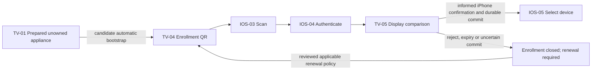
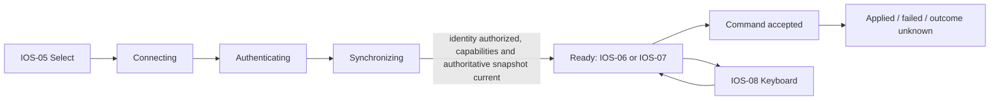
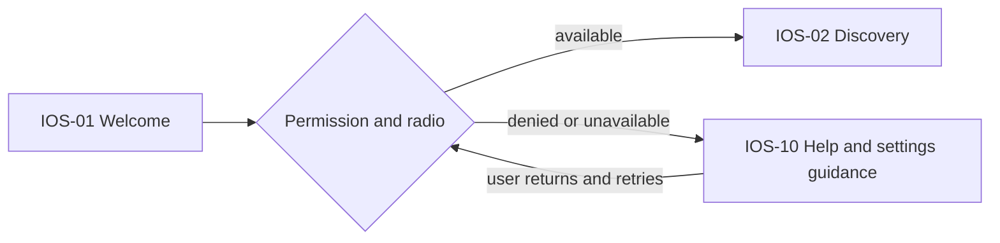
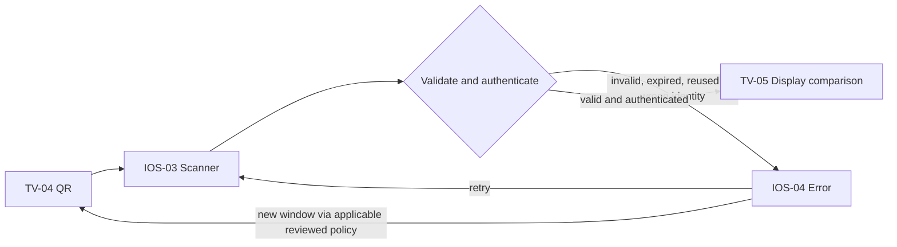
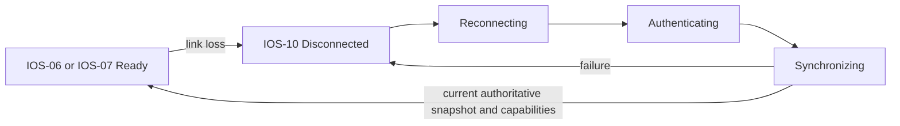
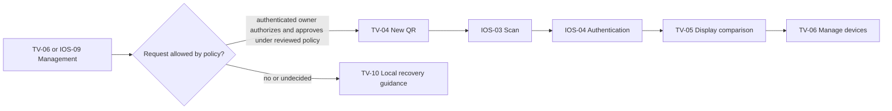
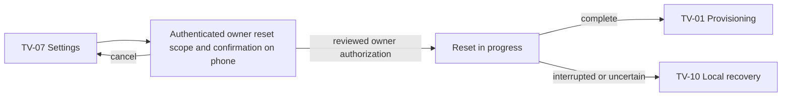
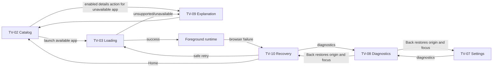

# UX flows

Proposed for review. Screen IDs refer to the [inventory](SCREEN_INVENTORY.md); state names and independent dimensions are defined in the [state model](UI_STATE_MODEL.md). Phone-based enrollment, recovery proof and owner authority remain subject to independent security approval. These diagrams describe conditional UX, not approved security mechanisms. [Protocol](../architecture/BLE_PROTOCOL.md) and [recovery](../architecture/RECOVERY.md) govern the proposed boundaries.

## 1. First boot and secure enrollment

The candidate QR is one-use and expires; possession of its secret is proposed bootstrap authorization, not proof of independent physical presence. Authenticate the intended identity, bind enrollment to the session, and show success only after commit. The candidate phone confirmation is not an approved security mechanism; if no reviewed scheme is acceptable, production is blocked.

## 2. Normal connection and authenticated control

Enable only supported controls while Ready. Accepted is queued, applied is the adapter boundary, and neither proves provider playback. Media and volume are capability dependent.

## 3. Bluetooth unavailable and permission denial

Explain the specific condition and offer platform settings guidance; do not repeatedly prompt or infer revocation.

## 4. Invalid, expired and wrong-device QR

Fail closed; never display the payload or treat discovery hints as identity. Never-owned bootstrap renewal requires a reviewed policy; owned-device renewal requires authenticated authorization.

## 5. Connection loss, reconnect and synchronization

Disable commands immediately; release held keys. Playback may continue. Reconcile unknown outcomes rather than replay non-idempotent commands; a revision gap also leaves Ready.

## 6. Adding or replacing a controller

An ordinary controller is not assumed to have owner authority. Replacement does not automatically revoke the old identity; revoke separately through an authorized path.

## 7. Revocation and all-devices-lost recovery

The remote action is offered only if policy authorizes it. Outage alone is not revocation; recovery does not silently erase identity or provider profiles.

## 8. Factory reset

Reset revokes controller credentials and rotates device identity. Settings and provider profiles are erased only when explicitly included and confirmed. Fail closed on interruption; exact authorization and recovery remain gated.

## 9. Application lifecycle and browser recovery

Runtime lifecycle is independent of session state. Display actionable failure, preserve trusted state and profiles, and avoid claiming provider compatibility or playback without evidence.
