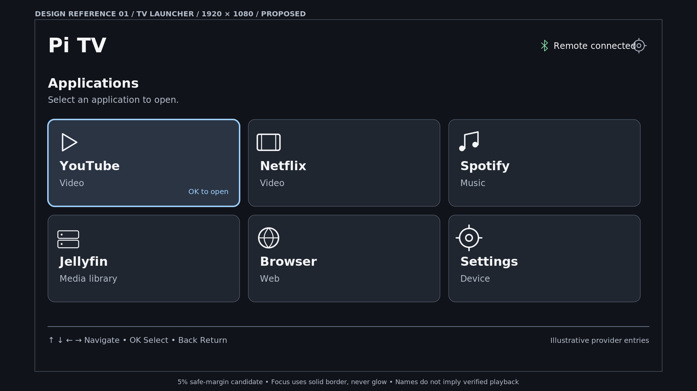
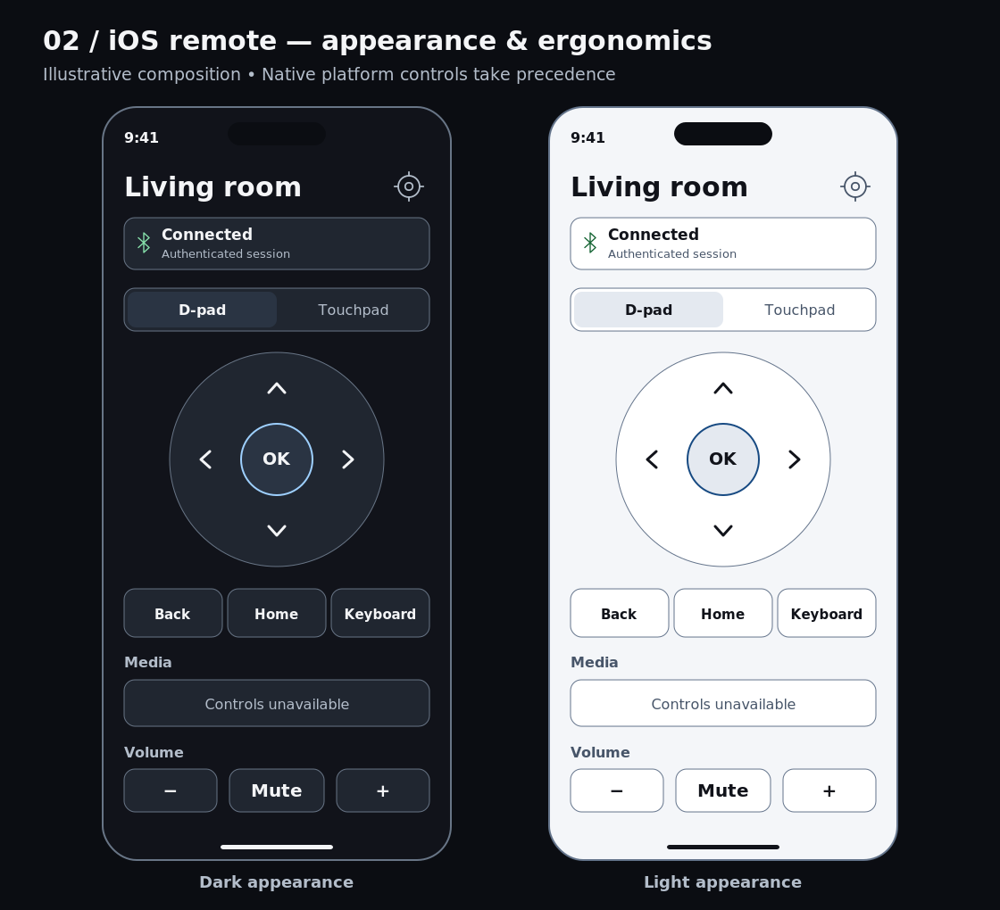
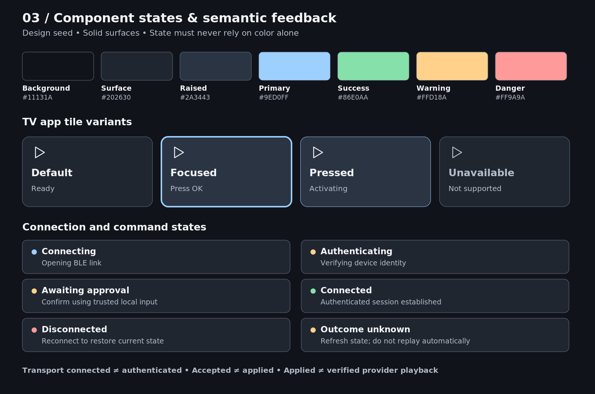

# Design brief — Pi TV (candidate visual direction)

## Scope and hierarchy

Modern iOS-first BLE remote, Raspberry Pi 4B 1 GB entertainment appliance. Design for TV at a distance and a phone at arm's length. Share semantic meaning, not identical control sizes or layouts. The active PRD R-19, R-02–R-08 and R-20–R-23 govern behaviors. Use the existing design seed and the reference boards to accelerate decisions. All visual choices below are proposals; preserve known security and hardware gates.

| Priority | Direction |
|---|---|
| 1 | Legibility, clear spatial focus and reliable state feedback |
| 2 | Native iOS ergonomics, accessibility and predictable remote interaction |
| 3 | Low rendering overhead, static assets and bounded motion |
| 4 | Original visual identity, semantic tokens and composable components |

## TV reference

- 1920 × 1080 reference canvas; validate 1280 × 720 by proportional layout and legibility review, not by assuming a screenshot scales correctly. Proposed 5% safe margins. At 1080p: 48 px title, 32 px section, 24 px body, 20 px metadata seed; illustration uses some larger headings for emphasis. Define a canonical type scale in active tokens and resolve any illustration/seed mismatch explicitly.
- Proposed 3-column application grid, 24 px gutters, solid surfaces, generic local icons and visible text. Grid count adapts to actual content and safe area; no unnecessary carousel, hero art, autoplay or content aggregation.
- Focus is a single high-contrast solid outline, separate from selection/activation. Candidate 4 px focus stroke at 1080p. Directional selection uses spatial rows/columns; disabled policy, modal trap and focus restoration must be documented. Never copy the linear prototype keyboard handler.
- Show authenticated remote status as a small, stable indicator. Show unavailable providers truthfully; board entries are illustrative only, not release claims. No perpetual animation or background polling merely for decoration.

## iOS reference

- SwiftUI native conventions are the preferred candidate. The board is a composition sketch, not a template to recreate pixel-for-pixel. Respect safe areas, system navigation, Dynamic Type and VoiceOver; no fixed-size frame that breaks accessibility. A 44×44 pt minimum interactive area is the candidate baseline; separately test D-pad sectors and touchpad gesture alternatives.
- D-pad is primary; touchpad mode is explicit, with scroll and sensitivity rules. Back, Home, Keyboard, volume and mute are accessible without a decorative overlay. Media controls are capability dependent, not always enabled. The displayed connected state is hypothetical and means application authentication succeeded, not merely a BLE link.
- Use system appearance and platform typography. Light/dark share semantic roles; dynamic system colors or documented mappings may supersede the seed where accessibility requires. Respect Reduce Motion and optional haptics. No video relaying or LAN onboarding in MVP.

## Component/state reference

- Keep component anatomy, variants, accessibility semantics and event contracts separate from feature logic. Colors alone never convey state. Distinguish default, focus, pressed, disabled/unavailable, loading and error. Pressed is transient feedback, not successful command execution.
- Map presentation to proposed BLE/application states: discovering, connecting, authenticating, awaiting trusted approval, authenticated, disconnected, reconnecting, revoked, permission denied, wrong identity, expired QR, stale state, busy, unsupported and unknown outcomes. Display actionable recovery. An accepted command is not applied; applied does not imply verified provider playback.
- Do not expose pairing secrets, raw protocol payloads or provider credentials in design components. No real QR in reference assets. First boot and all-devices-lost enrollment rely on approved trusted local recovery; existing-controller approval remains conditional. Refer to RECOVERY.md.

## Token and performance policy

The previous handoff token JSON is the starting seed. Resolve semantic names and contrast for actual foreground/background, control boundaries and focus indicators (WCAG AA target: normal text 4.5:1, large text 3:1, applicable non-text controls 3:1). Define platform-specific dimensions, disabled states and motion policy; 120/180 ms seed, 0 ms for reduced motion where appropriate. Do not treat every possible token pairing as valid. Generate or map CSS/Swift representations deterministically and specify drift checks; no unnecessary runtime token framework.

Candidate initial compressed launcher JS <=200 KiB; measure actual production bundle later. No decorative gradients, blur, halos, animated background, remote fonts, runtime image downloads for launcher, or heavy UI dependency added solely for visual effect. System fonts/native controls first. Component-library adoption requires separate dependency assessment. Full screen inventory, annotated wireframes and end-to-end flows remain Session 1C.3; this pack is intentionally a visual foundation, not that deliverable.
